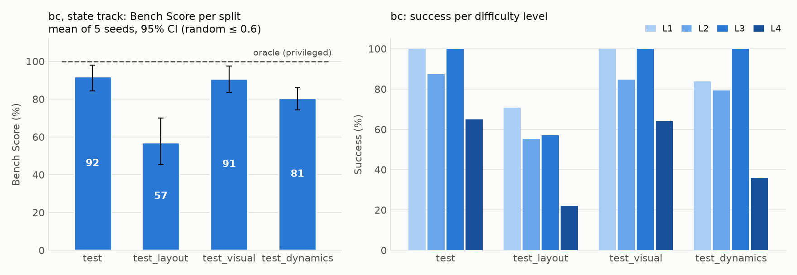
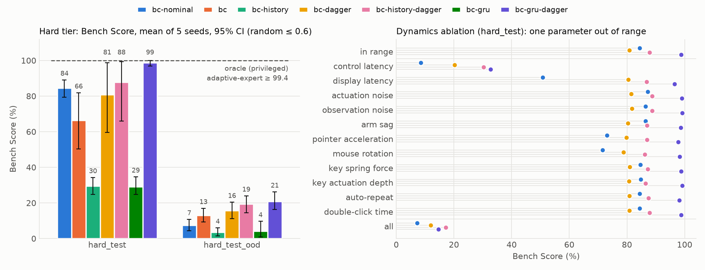

# ComputerXRobot-Bench v1.1

**Embodied computer use.** A robot arm must operate a computer through its physical devices:
press keys on a 44-key keyboard and drag and click a two-button mouse. The goal is to complete
desktop tasks: typing, opening apps and files, right-click menus, web search, and multi-step
edits. Success is judged only from the state of the simulated desktop. Test episodes use
strings, queries and files held out from training (tasks with a fixed set, such as single keys
or apps, reuse it), and three test splits also shift the scene outside the training
distribution.

The benchmark measures what screen-only computer-use agents and language-conditioned
manipulation benchmarks each leave out:

- **Contact-rich device control:** millimetre key presses; a relative mouse that has to be
  servoed closed-loop on the cursor; switching between mouse buttons.
- **Grounding:** reading key legends and screen text from cameras (vision track).
- **Long-horizon composition:** up to four sub-goals across apps.
- **Robustness:** to device layout, appearance and device dynamics.

| | |
|---|---|
| Version | 1.1.0 (`benchmark/__init__.py`). 1.1 adds the hard tier and the dynamics-prediction track; the 1.0 splits and results are unchanged |
| Tasks | 9 tasks in 4 difficulty levels |
| Splits | `train`, `val` (model selection), and 4 test splits of 180 episodes (20 per task): `test`, `test_layout`, `test_visual`, `test_dynamics` |
| Hard tier | realistic physics with **hidden real-world dynamics** inferred from interaction: `hard_train`, `hard_val`, `hard_test`, `hard_test_ood` |
| Dynamics-prediction track | predict how cursor and hand respond to actions under hidden dynamics (world models) |
| Tracks | `state` (privileged low-dimensional state) and `vision` (cameras, proprioception, instruction text) |
| Metric | Bench Score: success averaged over tasks, with a stratified-bootstrap 95% CI |
| Bounds | scripted oracle (privileged) **100.0** on every split, hard tier included; the same expert without privileged access, identifying the hidden dynamics online, **100.0** on `hard_test` and **99.4** on `hard_test_ood`; random **≤ 0.6** on every split |
| Compute | CPU only; ~2,000 env steps/s per core in the state track, ~70 in the vision track |

## Contents

1. [Tasks](#tasks)
2. [Splits and generalisation axes](#splits-and-generalisation-axes)
   - [Hard tier: hidden real-world dynamics](#hard-tier-hidden-real-world-dynamics)
   - [Dynamics-prediction track](#dynamics-prediction-track)
3. [Tracks: what an agent sees](#tracks-what-an-agent-sees)
4. [Actions and control](#actions-and-control)
5. [Evaluation protocol](#evaluation-protocol)
6. [Metrics](#metrics)
7. [Baselines and results](#baselines-and-results)
   - [Hard tier](#hard-tier)
   - [Dynamics ablation](#dynamics-ablation)
   - [Dynamics-prediction results](#dynamics-prediction-results)
8. [Reproducing the results](#reproducing-the-results)
9. [Evaluating your own agent](#evaluating-your-own-agent)
10. [Validity checks](#validity-checks)
11. [Datasheet and limitations](#datasheet-and-limitations)

## Tasks

Levels count the distinct sub-goals and skills an episode chains. Content items are the
strings, queries, apps or files a task is instantiated with; train and test items are disjoint
except where a task has only a fixed set (every key for `type_key`, every app for `open_app`).

| Level | Task | Example instruction (test) | Success when | Time limit | Items train / test |
|---|---|---|---|---|---|
| L1 | `type_key` | Press the "a" key | editor text is exactly the character | 7 s | 36 / 36 |
| L1 | `open_app` | Open the browser app | that app is in front | 12 s | 3 / 3 |
| L1 | `close_window` | Close the files window | no app is open | 12 s | 2 / 1 |
| L2 | `type_text` | Type "arm" in the text editor | editor text equals the string | 6 s + 1 s/char | 18 / 9 |
| L2 | `clear_text` | Clear the editor with the right-click menu | the prefilled editor is empty | 15 s | 5 / 3 |
| L2 | `open_file` | Open the file papers.txt | that file is open in the editor | 15 s | 3 / 2 |
| L3 | `search` | Search the web for "robotics research papers" | results page for exactly that query | 15 s + 1 s/char | 8 / 4 |
| L3 | `open_result` | Search for "…" and open "…" | that result page is open | 25 s + 1 s/char | 3 / 2 |
| L4 | `write_note` | Replace the draft in the editor with "send report" | editor shows the note (and nothing else) | 20 s + 1 s/char | 5 / 3 |

Skills involved: typing (all L2+ text tasks); left-click on dock, window, file, search and
result widgets; right-click and context-menu selection (`clear_text`, `write_note`); dragging
the mouse to a widget (every click task). A typo is recoverable: the task then expects
backspace. A missed click can be retried. There is no partial credit in the score.

## Splits and generalisation axes

| Split | Content | Scene distribution | What it tests |
|---|---|---|---|
| `train` | train items | `id` | data for imitation / RL (not a test split) |
| `val` | train items | `id` | model selection and hyperparameters (own seeds; not a test split) |
| `test` | held-out items | `id` | unseen strings and queries in familiar scenes |
| `test_layout` | held-out items | `ood_layout` | keyboard and mouse placed beyond the training range |
| `test_visual` | held-out items | `ood_visual` | unseen lighting, desk colour, floor, wallpaper, camera offset |
| `test_dynamics` | held-out items | `ood_dynamics` | unseen cursor gain (mouse DPI), key stiffness, mouse friction |

Scene distributions (`environment/variation.py`). Each OOD range is disjoint from the `id`
range on its axis and equal to `id` on the others; `tests/test_benchmark.py` checks this.

| Axis | `id` (train and `test`) | OOD |
|---|---|---|
| Keyboard offset (x, y) | ±2 cm, −2.5…+3 cm | `ood_layout`: \|x\| 3–4.5 cm, y +4…+6 cm |
| Mouse / pad offset (x, y) | ±2 cm, −3…+2 cm | `ood_layout`: \|x\| 3–4.5 cm, y −7…−4 cm |
| Light intensity, direction | ×0.8–1.2, ±0.3 rad | `ood_visual`: ×0.45–0.6 or ×1.5–1.7, \|0.6–1.0\| rad |
| Desk colour, wallpaper | 4 wood tones, 4 blues | `ood_visual`: 4 unseen desk colours, 4 unseen wallpapers |
| Floor brightness | ×0.85–1.15 | `ood_visual`: ×0.5–0.65 or ×1.4–1.6 |
| Robot-camera offset | ±0.8 cm per axis | `ood_visual`: 1.5–2.5 cm per axis |
| Cursor gain | 5,600–7,200 px/m | `ood_dynamics`: 4,000–4,800 or 8,400–9,600 px/m |
| Key stiffness | ×0.9–1.1 | `ood_dynamics`: ×1.3–1.5 |
| Mouse friction | ×0.8–1.2 | `ood_dynamics`: ×1.6–2.0 |

Episode specs (task, item, scene distribution, seed) are a pure function of the split. Seeds
are stable hashes of `(split, task, index)`, so every machine evaluates the same 180
episodes per split (`python -m benchmark list`).

## Hard tier: hidden real-world dynamics

The standard splits vary the scene, but every episode obeys the same idealised physics. In
the hard tier the physics itself is realistic and **varies per episode in ways the agent never
observes**. As with a real robot at a real computer, the agent has to infer how this
particular world responds, from the consequences of its own actions, within the episode.

| Hidden parameter (`environment/dynamics.py`) | Real-world effect | `real_id` (train, `hard_test`) | `real_ood` (`hard_test_ood`) |
|---|---|---|---|
| Control latency | commands take effect late | 0–1 steps (0–20 ms) | 2–4 steps (40–80 ms) |
| Display latency | the monitor (and the cursor seen on it) lags | 0–2 frames | 3–5 frames |
| Actuation noise | per-step error on the hand target | 0–0.2 mm | 0.3–0.5 mm |
| Observation noise | noisy proprioception, positions and cursor | 0–0.3 mm | 0.5–0.8 mm |
| Gravity compensation | the arm sags under its weight | 95–100% | 85–90% |
| Pointer acceleration | fast mouse motion moves the cursor further | +0–50% gain per 0.15 m/s | +80–120% |
| Mouse rotation | the optical sensor reads motion in the mouse's own frame, so a rotated mouse moves the cursor diagonally; dragging can rotate it further | ±8.6° at start | 14–23° at start |
| Key spring force | switch-to-switch variation, per key | ×0.8–1.4 | ×1.5–1.9 |
| Key actuation depth | per key, fraction of the 4 mm travel | 50–70% | 75–85% |
| Keyboard auto-repeat | a key held too long types again at 30 Hz | after 0.45–0.6 s | after 0.25–0.35 s |
| Double-click time | files open only on a double-click, two clicks within this window and 4 px | 0.4–0.5 s | 0.28–0.33 s |

**Where the ranges come from.** They are not calibrated to one robot or computer. Where
published measurements or platform defaults exist, the ranges are anchored to them; the rest
are stated as assumptions.

| Parameter | Reference values | How the ranges relate |
|---|---|---|
| Control latency | A UR5 arm's motor signals respond 2–3 packets (16–24 ms) after a command sent over wired Ethernet. Over Wi-Fi, packet inter-arrival times ranged 0.2–127 ms, and an injected action-update delay of 80 ms on average degraded learning (Mahmood et al., 2018) | `real_id` (0–20 ms): a wired arm; `real_ood` (40–80 ms): a wireless link or slow policy inference |
| Display latency | Mouse-click-to-screen latency of a laptop, mouse and monitor: 40–85 ms (Schmid & Wimmer, 2021). Most end-to-end latency comes from the display side (Casiez et al., 2017). A lag of 75 ms measurably slows pointing (MacKenzie & Ware, 1993) | The simulated computer is otherwise instantaneous: `real_id` (0–40 ms) is a fast setup; `real_ood` (60–100 ms) is an ordinary desktop |
| Actuation and observation noise | Pose repeatability (ISO 9283): ±0.1 mm for the Franka Emika Panda, ±0.03 mm for the UR5e (manufacturer datasheets) | `real_id` is at most a few times that repeatability; `real_ood` (0.3–0.8 mm) is several times more |
| Gravity compensation | Assumption: an error of up to 15% in the arm's mass model | – |
| Pointer acceleration | Desktop operating systems' default transfer functions raise the cursor gain with device speed. Compared with a constant gain, they improve pointing performance by up to 24% (Casiez & Roussel, 2011) | Gain × (1 + a · min(v / 0.15 m/s, 2)): at speed, up to 2× (`real_id`) or 2.6–3.4× (`real_ood`). The magnitudes are an assumption |
| Mouse rotation | Optical sensors report motion in their own frame, so the effect follows from the geometry. How far a mouse sits rotated is an assumption | – |
| Key spring force and depth | Cherry MX: 45 cN (Red), 60 cN (Black), 70 cN (Green) actuation force; actuation at 2.0 mm of 4.0 mm travel (manufacturer datasheets), with a tolerance of about ±0.6 mm | Force multipliers ×0.8–1.4 around nominal (`real_id`) and ×1.5–1.9 (`real_ood`, from the Red-to-Green ratio of 1.56 upward). Depth 50–70% of travel (`real_id`) and 75–85% (`real_ood`, past the tolerance) |
| Keyboard auto-repeat | Windows offers four delays from about 250 ms to about 1 s (Win32 `SPI_GETKEYBOARDDELAY`); the X server default is 660 ms at 25 Hz | `real_id` (0.45–0.6 s): around the defaults; `real_ood` (0.25–0.35 s): the shortest settings |
| Double-click time | Windows default 500 ms (Win32 `SetDoubleClickTime`); GTK/GNOME default 400 ms (250 ms before 2016) | `real_id` (0.4–0.5 s): the defaults; `real_ood` (0.28–0.33 s): a fast user setting |

The realistic profile (`EnvConfig(physics="realistic")`) also changes the scene:

- the mouse rotates on its pad (a hinge with friction);
- finger-key and finger-button contacts are rigid, like real keycaps;
- every time limit is 1.5× longer.

Scene variation is the `id` distribution throughout. Nominal physics, i.e. all of v1.0, is
unchanged bit for bit (`tests/test_hard_dynamics.py`).

The scripted oracle stays a valid upper bound because it may read the hidden parameters:

- it plans from the hand target that commands already in flight will reach;
- it maps cursor corrections through the mouse's rotation and its current effective gain;
- it scales its loop gain by the latency, and compensates sag.

It scores 100.0 on `hard_val`, `hard_test` and `hard_test_ood`, and under every condition of
the dynamics ablation.

**The hard tier is solvable without privileged access, but only by identifying the dynamics.**
An upper bound that reads the hidden parameters does not show that an agent can succeed from
what it observes. `adaptive-expert` (`learning/adaptive.py`) runs the oracle's control law on
the `state` track and holds no reference to the simulator. Every quantity it needs is observed,
or identified online from the response to its own commands:

- **control latency:** the lag under which replaying its own commands reproduces the motion
  of the observed hand target; the commands still in flight then give the planned target;
- **display latency and the cursor mapping:** the cursor's gain and the mouse's rotation as a
  2×2 matrix, fitted by recursive least squares for every candidate lag. Refitting with
  forgetting follows pointer acceleration and further rotation. A Smith predictor estimates
  where the cursor already is from the lagging one;
- **observation noise:** from the keyboard's observed position, which never moves.

It scores 100.0 on `hard_test` and 99.4 [98.3, 100.0] on `hard_test_ood`. The same control law with
identification switched off, assuming nominal dynamics (`fixed-expert`), scores 88.3 and 1.7.
The out-of-range split can therefore be solved from observations, and solving it requires
inferring the dynamics.

A memoryless policy cannot infer any of these parameters. The hard tier therefore separates
agents that *adapt in context*, from the response to their own recent actions, from agents
that merely imitate. The learned baselines are behaviour cloning with and without a short
history of observations and actions, each also refined with DAgger, and the v1.0 policy applied
zero-shot. The two non-privileged scripted experts above are reported with them.

A single-factor **dynamics ablation** (`python -m benchmark ablate`, `benchmark/ablation.py`)
attributes failures to individual effects. It replays the `hard_test` episodes and pushes
exactly one hidden parameter beyond its training range. This is an analysis tool, not a split.

## Dynamics-prediction track

This track scores world models directly on knowing how the world will respond
(`benchmark/world_model.py`).

- **Given:** 20 control steps (0.4 s) of observations and commanded actions, under an episode's
  hidden dynamics, plus the next 20 commanded actions.
- **Predict:** the next 20 observations of the cursor (px) and the hand (mm).
- **Observations are what an agent sees:** the cursor lags under display latency and
  everything is noisy, so a model has to infer latency, gain, acceleration, mouse rotation and
  sag from the context.
- **Data:** trajectories of the perturbed oracle. Train on `hard_train`; evaluate on
  `hard_test` (training ranges) and `hard_test_ood` (beyond them).
- **Metrics:** mean cursor error over windows that start with the hand on the mouse, and mean
  hand error over all windows, at horizons of 1, 5, 10 and 20 steps (20–400 ms).
- **Baselines:**
  - persistence;
  - a physics-free kinematic prior: instant tracking and a linear unrotated mouse, which is
    exact if no hidden dynamics existed;
  - an MLP world model trained on `hard_train`.

```bash
python -m benchmark.world_model collect     # data/world_model_{train,test,test_ood}.npz
python -m benchmark.world_model train       # checkpoints/world_model.pt
python -m benchmark.world_model evaluate --out results/world_model.json
```

## Tracks: what an agent sees

| Track | Observations | Purpose |
|---|---|---|
| `state` | proprioception (`qpos`, `qvel`, `tool_pos`, `tool_target`, `finger`); positions of the mouse, the needed mouse button and the keyboard; cursor position; key / button / palm contact flags; the instruction; and the task's **next sub-goal** (character to type, or widget to click with which button and its screen position) | isolates control; an upper-bound setting for learning |
| `vision` | four RGB cameras: `robot_cam` 240×320, `keyboard_cam` 256×512, `mouse_cam` 320×320, `screen_cam` 400×640; proprioception; palm touch; the instruction text. **No** positions, cursor or sub-goals | the full problem: read keys and screen, find the cursor, plan |
| `vision_subgoal` | diagnostic, not a benchmark track: the `vision` track plus the state track's next sub-goal (what to type or click next, which button, where the target is on screen) | removes planning and screen reading but keeps perception for control, so comparing it with `vision` shows which one a vision policy lacks |

The harness removes everything a track does not allow before observations reach the agent.
The scripted oracle reads the simulator directly. It is reported as a privileged reference,
not as an entry in either track.

## Actions and control

A 50 Hz action `[dx, dy, dz, finger]`:

- `dx, dy, dz` move the hand's target; each component is clipped to ±6 mm per step.
- `finger` is the extension of a 30 mm finger, from 0 to 1.

Damped-least-squares IK and joint position servos (500 Hz physics) track the target with the
hand pointing down. Key and button presses register when a key or button travels past 60% of
its stroke. The mouse is relative: cursor motion is mouse travel × cursor gain. The Gymnasium
wrapper (`environment/gym_env.py`) exposes the same action normalized to [−1, 1].

## Evaluation protocol

1. **Train only on the `train` split** (content items and `id` scenes). Generating more data
   from that distribution (e.g. `ComputerXRobot/*-v0` with `split="train"`, `scene="id"`) is
   allowed. Select models and hyperparameters on `val`. Test splits must not be used for
   training, tuning or model selection.
2. **Evaluate on all four test splits** with the official episode lists: 20 per task, 180 per
   split, fixed seeds. Do not cherry-pick tasks or episodes.
3. **Report the track.** Results are only comparable within a track. Agents that read
   simulator state outside their track are marked privileged.
4. **Learned agents: at least 5 training seeds.** Report the mean Bench Score over seeds with
   its 95% interval from a bootstrap over seeds and episodes (`benchmark/stats.py`; the
   default of `python -m benchmark report`). A single run is reported with its bootstrap 95%
   CI over episodes.
5. **Report per-task and per-level success** and the error metrics alongside the score
   (`python -m benchmark report --table tasks|levels|errors`).

All agents see identical episodes, so two agents can be compared with paired tests on the
same split: `python -m benchmark report ... --table compare` gives the probability of
improvement and the score difference, each with a paired-bootstrap 95% interval.

## Metrics

| Metric | Definition |
|---|---|
| **Bench Score** | success rate per task, averaged over the 9 tasks (each task weighs the same) |
| 95% CI | percentile bootstrap, 2,000 resamples. Episodes are resampled within each task (stratified), and with several runs the seeds are resampled too; all seeds share one episode draw, since they play the same episodes (`benchmark/stats.py`) |
| IQM | interquartile mean of the per-(seed, task) success rates: the mean of the middle 50% (Agarwal et al., 2021). Robust to one collapsed seed or a task every agent solves |
| P(X > Y) | probability of improvement: for a random task, the chance that a random seed of X beats a random seed of Y (ties count half), averaged over tasks |
| Per-level success | mean success of the tasks of each level (L1–L4) |
| Time to success | simulated seconds, successful episodes only |
| Wrong keys | key presses that were not the character the task needed at that moment |
| Failed clicks | clicks that hit nothing or the wrong widget, or used the wrong button |
| Collisions | robot contacts with anything except key tops and mouse surfaces (onsets) |
| Failed contacts | the finger touched a key or button without actuating it |

## Baselines and results

Five baselines on the standard splits; the hard tier adds six learned ones
([below](#hard-tier)). The scripted oracle is reported as a privileged reference; it reads the
simulator state directly.

* **random**: uniform random actions (hand moves within ±6 mm per step, finger 0–1).
* **oracle (privileged)**: the scripted expert (`learning/scripted_policy.py`). It establishes
  that every episode is solvable.
* **adaptive-expert** and **fixed-expert** (state track, not learned): the oracle's control
  law without privileged access (`learning/adaptive.py`). `adaptive-expert` identifies the
  hidden dynamics online, `fixed-expert` assumes the nominal ones; see the
  [hard tier](#hard-tier-hidden-real-world-dynamics). They establish that every episode is
  solvable from the `state` track's observations alone.
* **bc** (state track): an MLP behaviour-cloning policy (`learning/policy.py`).
  * Inputs: the 70 state features.
  * Outputs: the expert's waypoint offset and finger command.
  * Data: 100 oracle demonstrations per task on `train` (893 kept, 179k samples). DART-style
    perturbations (Laskey et al., 2017) of the executed motion, 30% strength during key
    presses and mouse drags.
  * Model: 3×256 MLP, smooth-L1 loss (β = 0.05), AdamW (lr 10⁻³, cosine), batch 512, 80 epochs.
  * Seeds: 5, reported as the mean with a 95% bootstrap interval over seeds and episodes.



*Left: BC's Bench Score per test split (mean of 5 seeds; error bars: 95% bootstrap interval
over seeds and episodes). Right: its success per difficulty level.*

### Bench Score per split

Mean over 5 seeds for `bc` and single runs for the others, each with its 95% bootstrap interval.

| Agent | Track | test | test_layout | test_visual | test_dynamics | val |
|---|---|---|---|---|---|---|
| adaptive-expert | state | 100.0 [100.0, 100.0] | 100.0 [100.0, 100.0] | 100.0 [100.0, 100.0] | 100.0 [100.0, 100.0] | 100.0 [100.0, 100.0] |
| bc | state | 91.9 [84.3, 98.0] | 57.1 [45.3, 69.9] | 90.9 [83.6, 97.6] | 80.6 [74.2, 86.1] | 92.2 [84.7, 98.6] |
| fixed-expert | state | 100.0 [100.0, 100.0] | 100.0 [100.0, 100.0] | 100.0 [100.0, 100.0] | 100.0 [100.0, 100.0] | 100.0 [100.0, 100.0] |
| random | state | 0.0 [0.0, 0.0] | 0.0 [0.0, 0.0] | 0.6 [0.0, 1.7] | 0.0 [0.0, 0.0] | 0.0 [0.0, 0.0] |
| oracle (privileged) | state | 100.0 [100.0, 100.0] | 100.0 [100.0, 100.0] | 100.0 [100.0, 100.0] | 100.0 [100.0, 100.0] | 100.0 [100.0, 100.0] |

`bc` per seed on `test`: 98, 91, 100, 93 and 78 (IQM 100.0 [99.3, 100.0]).

### Success % per task: `test`

| Agent | Track | type_key (L1) | open_app (L1) | close_window (L1) | type_text (L2) | clear_text (L2) | open_file (L2) | search (L3) | open_result (L3) | write_note (L4) | Score |
|---|---|---|---|---|---|---|---|---|---|---|---|
| bc | state | 100 | 100 | 100 | 100 | 69 | 93 | 100 | 100 | 65 | 91.9 [84.3, 98.0] |
| random | state | 0 | 0 | 0 | 0 | 0 | 0 | 0 | 0 | 0 | 0.0 [0.0, 0.0] |
| oracle (privileged) | state | 100 | 100 | 100 | 100 | 100 | 100 | 100 | 100 | 100 | 100.0 [100.0, 100.0] |

### Success % per task: `test_layout`

| Agent | Track | type_key (L1) | open_app (L1) | close_window (L1) | type_text (L2) | clear_text (L2) | open_file (L2) | search (L3) | open_result (L3) | write_note (L4) | Score |
|---|---|---|---|---|---|---|---|---|---|---|---|
| bc | state | 100 | 64 | 48 | 97 | 14 | 55 | 53 | 61 | 22 | 57.1 [45.3, 69.9] |
| random | state | 0 | 0 | 0 | 0 | 0 | 0 | 0 | 0 | 0 | 0.0 [0.0, 0.0] |
| oracle (privileged) | state | 100 | 100 | 100 | 100 | 100 | 100 | 100 | 100 | 100 | 100.0 [100.0, 100.0] |

### Success % per task: `test_visual`

| Agent | Track | type_key (L1) | open_app (L1) | close_window (L1) | type_text (L2) | clear_text (L2) | open_file (L2) | search (L3) | open_result (L3) | write_note (L4) | Score |
|---|---|---|---|---|---|---|---|---|---|---|---|
| bc | state | 100 | 100 | 100 | 100 | 63 | 91 | 100 | 100 | 64 | 90.9 [83.6, 97.6] |
| random | state | 0 | 0 | 0 | 0 | 5 | 0 | 0 | 0 | 0 | 0.6 [0.0, 1.7] |
| oracle (privileged) | state | 100 | 100 | 100 | 100 | 100 | 100 | 100 | 100 | 100 | 100.0 [100.0, 100.0] |

### Success % per task: `test_dynamics`

| Agent | Track | type_key (L1) | open_app (L1) | close_window (L1) | type_text (L2) | clear_text (L2) | open_file (L2) | search (L3) | open_result (L3) | write_note (L4) | Score |
|---|---|---|---|---|---|---|---|---|---|---|---|
| bc | state | 100 | 69 | 82 | 98 | 64 | 76 | 100 | 100 | 36 | 80.6 [74.2, 86.1] |
| random | state | 0 | 0 | 0 | 0 | 0 | 0 | 0 | 0 | 0 | 0.0 [0.0, 0.0] |
| oracle (privileged) | state | 100 | 100 | 100 | 100 | 100 | 100 | 100 | 100 | 100 | 100.0 [100.0, 100.0] |

### Success % per level

| Split | L1 | L2 | L3 | L4 |
|---|---|---|---|---|
| `test` (bc) | 100 | 87 | 100 | 65 |
| `test_layout` (bc) | 71 | 55 | 57 | 22 |
| `test_visual` (bc) | 100 | 85 | 100 | 64 |
| `test_dynamics` (bc) | 84 | 79 | 100 | 36 |

### Errors and speed on `test`

| Agent | Track | Wrong keys | Failed clicks | Collisions | Failed contacts | Time to success (s) |
|---|---|---|---|---|---|---|
| bc | state | 0.00 | 0.00 | 0.00 | 0.00 | 4.3 |
| random | state | 2.41 | 0.04 | 17.55 | 0.99 | – |
| oracle (privileged) | state | 0.00 | 0.00 | 0.00 | 0.10 | 4.2 |

### Model selection for `bc`

Recipes were compared on `val` (10 episodes per task, seed 0). The selected one is in bold.

| Recipe (100 demonstrations per task) | `val` score |
|---|---|
| 3×256 MLP, 40 epochs | 76.7 |
| 3×512 MLP, 60 epochs, near-L1 loss (β = 0.005) | 23.3 |
| 3×512 MLP, 40 epochs | 98.9 |
| **3×256 MLP, 80 epochs** | **100.0** |

Disclosure: before `val` existed, a first recipe (40 demonstrations per task, almost no
perturbation during mouse drags, 40 epochs) was evaluated once on `test` and scored 22.2. Its
diagnosis led to the two changes above: more data and perturbations during drags. After that,
all selection was done on `val`.

### Findings

Every standard split is solvable from the state track alone: both non-privileged experts score
100.0 on every task of every standard split. Nominal physics has no hidden dynamics, so
identification is not needed there. BC's drops below are therefore failures of learning to
generalise, not infeasible episodes.

1. **Unseen content in familiar scenes is close to solved in the state track:** 91.9 [84.3,
   98.0], IQM 100.0. Given the next sub-goal, an MLP generalises to strings and queries it
   never saw, and on `test` it is as fast as the oracle (4.3 s mean time to success) with no
   errors. Four seeds score 91–100. Seed 4 (78) never learned the right-click menu:
   `clear_text` 0, `write_note` 5.
2. **Device layout is the hardest shift:** 57.1 [45.3, 69.9], a 35-point drop.
   - BC still types: `type_key` 100, `type_text` 97.
   - It loses the mouse when the mouse is placed beyond its training range: `clear_text` 14,
     `write_note` 22, `close_window` 48.
3. **Device dynamics cost 11 points:** 80.6 [74.2, 86.1]. An unseen cursor gain and mouse
   friction mainly hurt the right-click and long-horizon tasks (`clear_text` 64, `write_note`
   36).
4. **Visual shift does not affect the state track** (90.9, against 91.9 on `test`), as
   designed. It targets the vision track.
5. **Longer tasks degrade most under shift.** L4 drops to 22% on `test_layout` and 36% on
   `test_dynamics`. Seed variance under shift is large (38–78 per seed on `test_layout`), so
   learned agents need several seeds.
6. **The vision track is open.** No learned agent has been evaluated on it yet; it requires
   reading keys and screen and planning without sub-goals.

### Hard tier

Realistic physics with hidden per-episode dynamics. The learned agents have 5 seeds each; the
MLP agents use the `bc` recipe above.

* **adaptive-expert** and **fixed-expert**: the non-privileged scripted experts
  ([above](#hard-tier-hidden-real-world-dynamics)), with and without online identification of
  the hidden dynamics. Deterministic and not trained: one run each.
* **bc-nominal**: the `bc` checkpoints above, trained in nominal physics, applied zero-shot.
* **bc**: trained on 100 oracle demonstrations per task on `hard_train`, under hidden
  dynamics (894 of 900 episodes kept, 202k samples). The oracle reads the hidden parameters,
  so this is imitation of a *privileged* teacher.
* **bc-history**: as `bc`, with the previous 4 feature vectors and commanded actions as extra
  inputs (366 inputs). Only a history can reveal latency, gain or rotation.
* **bc-gru**: recurrent behaviour cloning (`learning/recurrent.py`). A GRU carries a state
  from the first step of the episode, so the policy can integrate evidence about the dynamics
  over seconds rather than 4 steps.
  * Inputs per step: the 70 features and the previously executed action.
  * Model: 2×256 MLP encoder, GRU (256), MLP head on the encoding and the GRU state.
  * Training: truncated backpropagation through time in 128-step segments, 8 episodes per
    batch, 60 epochs, AdamW (lr 10⁻³, cosine), the `bc` loss. Batch size and epochs were chosen
    by held-out loss on `hard_train` (0.017, against 0.026 for `bc-history`).
* **bc-dagger**, **bc-history-dagger** and **bc-gru-dagger**: `bc`, `bc-history` and `bc-gru`
  after two DAgger iterations (Ross et al., 2011).
  * In each iteration the current student plays 25 `hard_train` episodes per task.
  * The oracle labels every state the student visits, failed episodes included (51k–293k
    samples per iteration).
  * The student is retrained from scratch on all data so far.

Bench Score: mean over 5 seeds for the learned agents, single runs for the others, each with
its 95% bootstrap interval over seeds and episodes.

| Agent | Track | hard_test | hard_test_ood | hard_val |
|---|---|---|---|---|
| bc-nominal (zero-shot) | state | 84.4 [79.3, 89.1] | 7.4 [4.3, 10.8] | – |
| bc | state | 66.3 [50.3, 81.9] | 13.0 [9.2, 17.0] | 70.1 [54.1, 84.6] |
| bc-history | state | 29.6 [24.8, 34.3] | 3.6 [1.4, 6.0] | 31.6 [25.7, 37.4] |
| bc-gru | state | 29.1 [24.7, 34.7] | 4.1 [0.8, 9.7] | 27.3 [22.9, 32.6] |
| bc-dagger | state | 80.8 [59.6, 98.7] | 15.8 [11.2, 20.4] | 80.4 [58.6, 99.4] |
| bc-history-dagger | state | 87.8 [66.0, 99.4] | 19.3 [14.4, 24.0] | 88.0 [66.0, 99.7] |
| **bc-gru-dagger** | state | **98.8 [96.9, 99.9]** | **20.9 [16.2, 26.2]** | **99.7 [99.0, 100.0]** |
| random | state | 0.6 [0.0, 1.7] | 0.0 [0.0, 0.0] | 0.0 [0.0, 0.0] |
| fixed-expert (scripted, no identification) | state | 88.3 [83.9, 92.8] | 1.7 [0.0, 3.9] | 93.3 [90.0, 96.7] |
| **adaptive-expert** (scripted, online identification) | state | **100.0 [100.0, 100.0]** | **99.4 [98.3, 100.0]** | **100.0 [100.0, 100.0]** |
| oracle (privileged) | state | 100.0 [100.0, 100.0] | 100.0 [100.0, 100.0] | 100.0 [100.0, 100.0] |



*Left: hard-tier Bench Score of the learned agents (mean of 5 seeds; error bars: 95% bootstrap
interval over seeds and episodes). The dashed line is the privileged oracle (100.0); the
non-privileged `adaptive-expert` scores at least 99.4 on both splits. Right: the dynamics
ablation, mean of 5 seeds; the [table below](#dynamics-ablation) gives the values and
intervals. Each agent has one colour in both panels.*

#### Mean, interquartile mean and seeds

The interquartile mean (IQM) is the mean of the middle half of the per-(seed, task) success
rates, so one collapsed seed moves it little.

`hard_test`:

| Agent | Mean [95% CI] | IQM [95% CI] | Per seed |
|---|---|---|---|
| bc-nominal | 84.4 [79.3, 89.1] | 94.8 [88.0, 98.9] | 89, 81, 91, 78, 83 |
| bc | 66.3 [50.3, 81.9] | 79.1 [50.7, 91.1] | 63, 37, 87, 63, 83 |
| bc-history | 29.6 [24.8, 34.3] | 12.8 [4.6, 21.7] | 34, 24, 31, 34, 24 |
| bc-gru | 29.1 [24.7, 34.7] | 10.7 [2.8, 21.3] | 31, 38, 24, 23, 28 |
| bc-dagger | 80.8 [59.6, 98.7] | 98.5 [68.7, 100.0] | 99, 64, 44, 98, 98 |
| bc-history-dagger | 87.8 [66.0, 99.4] | 99.6 [81.3, 100.0] | 99, 97, 99, 99, 44 |
| bc-gru-dagger | 98.8 [96.9, 99.9] | 100.0 [100.0, 100.0] | 99, 99, 100, 99, 96 |

`hard_test_ood`:

| Agent | Mean [95% CI] | IQM [95% CI] | Per seed |
|---|---|---|---|
| bc-nominal | 7.4 [4.3, 10.8] | 1.1 [0.0, 3.0] | 7, 7, 8, 9, 7 |
| bc | 13.0 [9.2, 17.0] | 7.6 [3.0, 11.3] | 16, 11, 12, 10, 16 |
| bc-history | 3.6 [1.4, 6.0] | 0.4 [0.0, 0.9] | 6, 3, 4, 4, 1 |
| bc-gru | 4.1 [0.8, 9.7] | 0.9 [0.0, 2.2] | 1, 14, 2, 2, 2 |
| bc-dagger | 15.8 [11.2, 20.4] | 11.7 [6.1, 15.9] | 14, 15, 17, 22, 11 |
| bc-history-dagger | 19.3 [14.4, 24.0] | 11.3 [6.5, 15.9] | 17, 18, 23, 23, 16 |
| bc-gru-dagger | 20.9 [16.2, 26.2] | 13.5 [8.5, 18.7] | 19, 20, 18, 19, 28 |

Paired comparisons on `hard_test` (the same episodes for every agent): the probability that X
beats Y on a random task and seed, and the difference in Bench Score.

| X vs Y | P(X > Y) % | Δ score |
|---|---|---|
| bc-gru-dagger vs bc-history-dagger | 57.6 [45.6, 67.6] | 11.0 [-1.6, 32.9] |
| bc-gru-dagger vs bc-dagger | 63.6 [50.9, 73.6] | 18.0 [0.0, 39.8] |
| bc-gru-dagger vs bc-nominal | 70.4 [58.9, 77.1] | 14.3 [9.2, 19.4] |
| bc-gru-dagger vs bc-gru | 86.7 [84.4, 88.9] | 69.7 [63.9, 74.4] |
| bc-history-dagger vs bc-dagger | 54.9 [38.2, 69.6] | 7.0 [-22.0, 32.8] |
| bc-history-dagger vs bc-history | 85.6 [69.1, 94.4] | 58.2 [34.7, 72.7] |
| bc-nominal vs bc | 65.1 [53.3, 74.2] | 18.1 [2.7, 35.4] |
| bc-history vs bc-gru | 48.9 [37.3, 62.7] | 0.4 [-6.8, 6.9] |

`python -m benchmark report results/hard_*.json results/nominal_bc_*.json --table compare
--split hard_test` lists every pair.

#### Success % per task: `hard_test`

| Agent | type_key (L1) | open_app (L1) | close_window (L1) | type_text (L2) | clear_text (L2) | open_file (L2) | search (L3) | open_result (L3) | write_note (L4) | Score |
|---|---|---|---|---|---|---|---|---|---|---|
| bc-nominal | 100 | 97 | 72 | 100 | 70 | 62 | 100 | 90 | 69 | 84.4 [79.3, 89.1] |
| bc | 79 | 95 | 68 | 65 | 79 | 92 | 38 | 40 | 41 | 66.3 [50.3, 81.9] |
| bc-history | 100 | 38 | 3 | 95 | 7 | 11 | 5 | 2 | 5 | 29.6 [24.8, 34.3] |
| bc-gru | 100 | 31 | 0 | 100 | 0 | 0 | 19 | 11 | 1 | 29.1 [24.7, 34.7] |
| bc-dagger | 77 | 99 | 100 | 71 | 100 | 100 | 56 | 59 | 65 | 80.8 [59.6, 98.7] |
| bc-history-dagger | 80 | 100 | 100 | 80 | 100 | 98 | 76 | 77 | 79 | 87.8 [66.0, 99.4] |
| bc-gru-dagger | 100 | 100 | 100 | 97 | 100 | 98 | 99 | 96 | 99 | 98.8 [96.9, 99.9] |
| random | 0 | 0 | 0 | 0 | 5 | 0 | 0 | 0 | 0 | 0.6 [0.0, 1.7] |
| fixed-expert | 95 | 100 | 100 | 80 | 100 | 100 | 60 | 65 | 95 | 88.3 [83.9, 92.8] |
| adaptive-expert | 100 | 100 | 100 | 100 | 100 | 100 | 100 | 100 | 100 | 100.0 [100.0, 100.0] |
| oracle (privileged) | 100 | 100 | 100 | 100 | 100 | 100 | 100 | 100 | 100 | 100.0 [100.0, 100.0] |

#### Success % per task: `hard_test_ood`

| Agent | type_key (L1) | open_app (L1) | close_window (L1) | type_text (L2) | clear_text (L2) | open_file (L2) | search (L3) | open_result (L3) | write_note (L4) | Score |
|---|---|---|---|---|---|---|---|---|---|---|
| bc-nominal | 32 | 3 | 3 | 28 | 0 | 0 | 1 | 0 | 0 | 7.4 [4.3, 10.8] |
| bc | 7 | 45 | 19 | 0 | 21 | 25 | 0 | 0 | 0 | 13.0 [9.2, 17.0] |
| bc-history | 7 | 22 | 0 | 0 | 1 | 2 | 0 | 0 | 0 | 3.6 [1.4, 6.0] |
| bc-gru | 6 | 21 | 3 | 1 | 3 | 3 | 0 | 0 | 0 | 4.1 [0.8, 9.7] |
| bc-dagger | 16 | 42 | 26 | 3 | 36 | 18 | 1 | 0 | 0 | 15.8 [11.2, 20.4] |
| bc-history-dagger | 7 | 54 | 53 | 1 | 40 | 19 | 0 | 0 | 0 | 19.3 [14.4, 24.0] |
| bc-gru-dagger | 21 | 60 | 45 | 3 | 43 | 14 | 0 | 0 | 2 | 20.9 [16.2, 26.2] |
| random | 0 | 0 | 0 | 0 | 0 | 0 | 0 | 0 | 0 | 0.0 [0.0, 0.0] |
| fixed-expert | 5 | 0 | 10 | 0 | 0 | 0 | 0 | 0 | 0 | 1.7 [0.0, 3.9] |
| adaptive-expert | 100 | 100 | 100 | 100 | 100 | 95 | 100 | 100 | 100 | 99.4 [98.3, 100.0] |
| oracle (privileged) | 100 | 100 | 100 | 100 | 100 | 100 | 100 | 100 | 100 | 100.0 [100.0, 100.0] |

#### Errors per episode and mean time to success

| Agent | Split | Wrong keys | Failed clicks | Collisions | Failed contacts | Time to success (s) |
|---|---|---|---|---|---|---|
| bc-nominal | `hard_test` | 0.01 | 9.10 | 0.13 | 5.99 | 5.3 |
| bc-history-dagger | `hard_test` | 1.98 | 0.03 | 0.01 | 3.89 | 5.5 |
| bc-gru-dagger | `hard_test` | 0.74 | 0.01 | 0.00 | 4.01 | 5.0 |
| fixed-expert | `hard_test` | 11.37 | 0.07 | 0.00 | 13.35 | 7.8 |
| adaptive-expert | `hard_test` | 0.01 | 0.00 | 0.00 | 3.18 | 4.8 |
| oracle (privileged) | `hard_test` | 0.00 | 0.00 | 0.00 | 3.05 | 4.6 |
| bc-nominal | `hard_test_ood` | 1.23 | 2.11 | 67.39 | 5.03 | 6.5 |
| bc | `hard_test_ood` | 14.15 | 3.52 | 78.31 | 18.86 | 6.3 |
| bc-history | `hard_test_ood` | 4.03 | 0.77 | 13.90 | 7.53 | 7.8 |
| bc-gru | `hard_test_ood` | 13.25 | 2.18 | 17.39 | 13.94 | 6.1 |
| bc-dagger | `hard_test_ood` | 8.96 | 2.25 | 93.58 | 14.67 | 8.0 |
| bc-history-dagger | `hard_test_ood` | 7.41 | 1.06 | 13.56 | 13.05 | 5.9 |
| bc-gru-dagger | `hard_test_ood` | 15.50 | 1.33 | 25.49 | 15.65 | 8.5 |
| fixed-expert | `hard_test_ood` | 11.26 | 1.25 | 33.43 | 13.36 | 5.3 |
| adaptive-expert | `hard_test_ood` | 0.17 | 0.61 | 0.28 | 7.84 | 7.3 |
| oracle (privileged) | `hard_test_ood` | 0.02 | 0.24 | 0.19 | 6.82 | 6.7 |

`python -m benchmark report results/*.json --table errors --split hard_test` lists every agent.

#### Findings

1. **The hard tier separates in-range adaptation from extrapolation.**
   - In range, the best learned agent (`bc-gru-dagger`) reaches 98.8 [96.9, 99.9].
   - Beyond the training range, every learned agent scores at most 20.9 [16.2, 26.2].
   - Without privileged access, a controller that identifies the dynamics online scores 99.4
     [98.3, 100.0] beyond the range, at every latency (98–100% at 40, 60 and 80 ms). The same
     controller assuming nominal dynamics scores 1.7.
   - The out-of-range gap (79 points) is therefore closable from observations, and closing it
     takes inferring the dynamics in context rather than memorising their range.
2. **Imitating a privileged teacher fails without on-policy data.**
   - The oracle acts on state the student cannot observe: commands still in flight, the true
     hand position, the mouse's rotation and gain.
   - Plain `bc` on `hard_train` (66.3 [50.3, 81.9]) scores *below* the nominal policy applied
     zero-shot (84.4 [79.3, 89.1]): 18.1 points [2.7, 35.4] lower.
   - It drifts into states the oracle never visits and has no label for them. For example, it
     settles 5 mm beside a key and never presses it; seed 1 types nothing at all.
   - Its seeds range from 37 to 87.
3. **Memory helps only with DAgger.**
   - Without DAgger, a 4-step history and a recurrent state both halve the score: `bc-history`
     29.6 and `bc-gru` 29.1 (difference 0.4 [−6.8, 6.9]). Both type (`type_key` 100) and stall
     on mouse tasks (`clear_text` 7 and 0, `close_window` 3 and 0). The policy copies its own
     recent actions, the "copycat" problem (de Haan et al., 2019; Wen et al., 2020). A longer
     memory does not remove it.
   - DAgger labels exactly those states. `bc-gru-dagger` gains 69.7 points [63.9, 74.4] over
     `bc-gru`, and `bc-history-dagger` 58.2 [34.7, 72.7] over `bc-history`.
   - Telling how much of the motion is still in flight takes the recent action history.
4. **With DAgger, the recurrent policy is the only one that is stable across seeds.**
   - `bc-gru-dagger` scores 96–100 on every seed. `bc-history-dagger` scores 97–99 on four
     seeds and 44 on the fifth; `bc-dagger` scores 98–99 on three seeds, 64 and 44.
   - A run at 44.4 never presses a key: it solves every episode of the four mouse-only tasks
     and none of the five tasks that need the keyboard (4 of 9 tasks). `bc-dagger`'s seed at
     64 types in about a third of those episodes.
   - The collapse is visible before testing: these runs score the same on `hard_val`, and the
     collapsed `bc-history-dagger` run ends training at twice the held-out loss of the other
     seeds (0.043 against 0.021–0.024). All seeds are reported here; none was retrained.
   - The mean therefore understates the typical run and the IQM hides the collapse:
     `bc-history-dagger` has mean 87.8 and IQM 99.6. Report both, with the per-seed scores.
   - With 5 seeds, the in-range advantage of `bc-gru-dagger` over `bc-history-dagger` (11.0
     points [−1.6, 32.9]) and of `bc-history-dagger` over `bc-dagger` (7.0 [−22.0, 32.8]) is
     not established. Its advantage over `bc-nominal` is (14.3 [9.2, 19.4]).
5. **A policy trained in idealised physics is robust in range and brittle beyond.**
   - `bc-nominal` keeps 84.4 in range. Most of its losses come from interaction timing and
     precise clicking.
   - It never learned to double-click. It opens files only when repeated clicks happen to
     fall within the double-click window: `open_file` 62%, with 15.3 clicks per episode
     against the oracle's 3.7.
   - On `close_window` it clicks 74 times per episode around the button.
   - Beyond the range it collapses to 7.4.
6. **Out of range, success falls off a latency cliff.** Success on `hard_test_ood`, by the
   episode's control latency (pooled over 5 seeds, 280–320 episodes each):

   | Agent | 40 ms | 60 ms | 80 ms |
   |---|---|---|---|
   | bc-nominal | 20.7 | 1.2 | 0.4 |
   | bc | 31.3 | 5.3 | 2.1 |
   | bc-dagger | 37.3 | 6.2 | 3.6 |
   | bc-history-dagger | 40.3 | 13.8 | 3.2 |
   | bc-gru-dagger | 40.0 | 15.0 | 7.1 |

   - Training covered at most 20 ms.
   - The policies with memory degrade most gracefully, but no learned policy copes with 80 ms.
     A recurrent state over the whole episode does not extrapolate further than a 4-step
     history: 20.9 against 19.3 overall (difference 1.6 [−3.8, 7.3]).
     `adaptive-expert` succeeds in 100.0%, 98.4% and 100.0% of episodes at 40, 60 and 80 ms;
     `fixed-expert` in 5.0%, 0.0% and 0.0%.
   - Memoryless policies also collide with the desk or keyboard 67–94 times per episode,
     against 14–25 for the history and recurrent policies.
   - The [dynamics ablation](#dynamics-ablation) confirms that latency, not the other
     effects, causes most of the collapse.
7. **DAgger also teaches recovery.**
   - `bc-gru-dagger` makes typos in long queries: 1.2 wrong keys per `search` episode and 3.8
     per `open_result` episode, against 0 for the oracle. `bc-history-dagger` makes 6.5 and
     8.8.
   - `bc-gru-dagger` still succeeds in 99% and 96% of those episodes, because it corrects each
     typo with backspace.
   - That recovery comes from the oracle's labels on the student's own mistakes.

### Dynamics ablation

Which real-world effect breaks which policy? The ablation replays 20 `hard_test` episodes per
task (all of them) under 13 conditions:

- **in range:** each episode's own `real_id` dynamics;
- **one parameter at a time:** pushed to its `real_ood` value, all others in range;
- **all:** every parameter pushed.

Learned agents: mean over 5 seeds with the 95% bootstrap interval over seeds and episodes.
The scripted experts are single deterministic runs (interval over episodes). `adaptive-expert`
and the oracle score 100.0 under every condition.

| Condition | bc-nominal | bc-dagger | bc-history-dagger | bc-gru-dagger | fixed-expert | adaptive-expert |
|---|---|---|---|---|---|---|
| in range | 84.4 [79.3, 89.1] | 80.8 [59.6, 98.7] | 87.8 [66.0, 99.4] | 98.8 [96.9, 99.9] | 88.3 [83.9, 92.8] | 100.0 |
| **control latency** (40–80 ms) | **8.4 [5.1, 11.8]** | **20.2 [15.3, 25.6]** | **30.3 [25.6, 34.7]** | **32.7 [26.4, 39.2]** | **11.7 [7.8, 15.6]** | 100.0 |
| display latency (60–100 ms) | 50.8 [44.8, 56.2] | 80.4 [59.2, 98.6] | 86.8 [65.3, 98.7] | 96.4 [92.6, 99.2] | 57.2 [51.1, 63.3] | 100.0 |
| actuation noise | 87.2 [82.0, 92.0] | 81.4 [59.8, 99.6] | 88.7 [66.4, 100.0] | 99.0 [97.6, 100.0] | 91.1 [87.2, 94.4] | 100.0 |
| observation noise | 86.4 [81.7, 90.8] | 81.7 [59.6, 100.0] | 88.7 [66.4, 100.0] | 99.2 [97.7, 100.0] | 93.3 [90.0, 96.7] | 100.0 |
| arm sag | 86.4 [81.8, 91.1] | 80.3 [59.4, 97.9] | 87.0 [65.4, 98.8] | 98.7 [96.7, 100.0] | 86.7 [82.2, 90.6] | 100.0 |
| pointer acceleration | 73.1 [66.4, 79.3] | 79.8 [58.6, 98.2] | 87.0 [65.4, 98.9] | 97.8 [95.8, 99.3] | 82.8 [77.8, 87.2] | 100.0 |
| mouse rotation | 71.6 [61.8, 80.1] | 78.8 [56.6, 97.6] | 86.1 [63.6, 98.6] | 98.2 [95.7, 99.9] | 86.1 [81.7, 90.6] | 100.0 |
| key spring force | 84.7 [79.4, 89.2] | 81.0 [59.7, 98.9] | 87.2 [65.7, 98.9] | 98.8 [97.1, 99.9] | 90.0 [86.1, 93.9] | 100.0 |
| key actuation depth | 84.8 [79.7, 89.2] | 80.7 [59.7, 98.3] | 86.4 [65.2, 98.1] | 99.1 [97.8, 100.0] | 87.2 [83.3, 91.1] | 100.0 |
| auto-repeat | 84.4 [79.3, 89.1] | 80.8 [59.6, 98.7] | 87.4 [65.8, 99.2] | 98.1 [95.8, 99.7] | 88.3 [83.9, 92.8] | 100.0 |
| double-click time | 84.4 [79.3, 89.1] | 80.8 [59.6, 98.7] | 87.8 [66.0, 99.4] | 98.8 [96.9, 99.9] | 88.3 [83.9, 92.8] | 100.0 |
| all | 7.2 [4.3, 10.3] | 12.0 [7.0, 18.1] | 17.1 [13.1, 21.4] | 14.7 [10.7, 19.4] | 1.1 [0.0, 2.8] | 100.0 |

1. **Control latency alone causes most of the collapse.**
   - Pushing only the latency out of range takes the best policy from 98.8 to 32.7. Pushing
     every parameter takes it to 14.7.
   - Every policy here reacts to the state it sees. Under 40–80 ms of latency, it must instead
     act on the state its commands in flight will produce, and none learned to do so beyond
     20 ms.
   - The policies with memory keep the most (32.7 and 30.3, against 20.2 without memory; the
     4-step history gains 10.1 points [4.6, 15.6] over `bc-dagger`), consistent with memory
     carrying the commands in flight.
2. **Visual and mouse dynamics break the policy that never saw them.**
   - `bc-nominal` loses 34 points to display latency, 13 to mouse rotation and 11 to pointer
     acceleration.
   - The policies trained under hidden dynamics lose at most 3 points to any of these.
   - Training under the in-range dynamics transfers to stronger versions of these effects, but
     not to stronger latency.
3. **Noise, sag, key forces and OS timing are absorbed.**
   - Out of range, actuation and observation noise, arm sag, key spring force and actuation
     depth, auto-repeat and double-click time each cost at most 2 points.
   - Some of these effects already cost the zero-shot policy in range (double-click,
     [finding 5](#findings-1)). The extra strength beyond the training range adds little.
4. **Effects compound.** "all" is below the worst single effect for every policy: 14.7
   against 32.7 for `bc-gru-dagger`, 17.1 against 30.3 for `bc-history-dagger`.
5. **Identification removes every failure.** With online identification the scripted expert
   scores 100.0 under every condition, "all" included. Without it, the same law fails on
   exactly the two effects that break the learned policies: control latency (11.7) and display
   latency (57.2). The ablation's failures are therefore failures to infer the dynamics, not
   effects that make the episodes infeasible.

### Dynamics-prediction results

Mean error at horizons of 1, 5, 10 and 20 steps (20–400 ms). Lower is better. The MLP is
trained on `hard_train` trajectories (360 episodes) and reported as mean ± std over 3 seeds.
`hard_test` has 2,104 windows (263 starting on the mouse); `hard_test_ood` has 3,550 (1,666).

| Model | Split | cursor px @1 | cursor px @5 | cursor px @10 | cursor px @20 | hand mm @1 | hand mm @5 | hand mm @10 | hand mm @20 |
|---|---|---|---|---|---|---|---|---|---|
| persistence | `hard_test` | 8.2 | 38.2 | 68.9 | 106.3 | 3.4 | 16.1 | 30.2 | 51.5 |
| kinematic | `hard_test` | 27.3 | 33.5 | 55.2 | 135.1 | 8.7 | 9.1 | 9.5 | 10.1 |
| **mlp** (3 seeds) | `hard_test` | **2.7** ± 0.1 | **6.1** ± 0.1 | **9.2** ± 0.1 | **14.3** ± 0.2 | **0.6** ± 0.0 | **1.2** ± 0.0 | **1.6** ± 0.0 | **2.6** ± 0.0 |
| persistence | `hard_test_ood` | 5.2 | 18.5 | 31.5 | 47.1 | 3.0 | 11.0 | 20.2 | 35.2 |
| kinematic | `hard_test_ood` | 21.8 | 29.2 | 40.6 | 61.4 | 7.2 | 9.1 | 11.4 | 14.0 |
| **mlp** (3 seeds) | `hard_test_ood` | **5.0** ± 0.1 | **15.3** ± 0.1 | **24.4** ± 0.2 | **31.6** ± 0.4 | **1.8** ± 0.0 | **3.8** ± 0.0 | **5.1** ± 0.0 | **6.9** ± 0.0 |

- **Within the training ranges, a learned model captures the hidden dynamics well.** It
  predicts the cursor 400 ms ahead to 14 px, where "nothing moves" is off by 106 px and the
  physics-free kinematic prior by 135 px. It predicts the hand to 2.6 mm.
- **Beyond them, it does not extrapolate.**
  - On `hard_test_ood` the cursor error at 400 ms more than doubles (31.6 px) and the hand
    error nearly triples (6.9 mm).
  - At 100 ms the cursor prediction (15.3 px) is barely better than persistence (18.5 px).
  - Longer latency, stronger acceleration and a more rotated mouse are not inferred from
    context; they are only fitted inside the training range.
- **The kinematic prior is the worst cursor predictor at long horizons** (135 px). Ignoring
  latency, acceleration and rotation is worse than predicting no motion at all.

## Reproducing the results

```bash
pip install -e .                     # or: pip install -r requirements.txt
PY=python WORKERS=8 sh scripts/run_cpu.sh   # every state-track result, 5 seeds (CPU)
sh scripts/run_gpu.sh                # the vision-track baseline (CUDA GPU; docs/GPU.md)
python -m benchmark report results/*.json --table splits            # Markdown tables
python -m benchmark report results/*.json --table tasks --split test --format latex
python -m benchmark.plot results/*.json --agent bc --out docs/benchmark_results.png
python -m benchmark.plot results/*.json --hard --out docs/hard_results.png
```

`scripts/run_cpu.sh` runs the five scripts below in order. Each skips every step whose output
exists, so an interrupted run resumes where it stopped; `SEEDS="0 1 2"` limits the seeds. The
standard and hard-tier baselines take about 3 hours on a 10-core laptop with 8 workers, the
dynamics ablation about 5 hours (~15 min per agent and seed), and the recurrent baseline most
of the rest: one `bc-gru` training run takes 0.5–1.5 h on the laptop CPU, three per seed with
DAgger.

`scripts/run_baselines.sh` (~25 min) does the following:

1. Collects oracle demonstrations on `train`: 100 per task, `id` scenes, DART-style
   perturbations (~3 min).
2. Trains five behaviour-cloning seeds (~30 s each on CPU).
3. Evaluates the oracle, random and the five seeds on `val` and every test split.

Each result file (`results/<agent>_<split>.json`) contains:

- every episode record (spec, success, time, return, error counts);
- the summary;
- metadata: benchmark version, git commit, whether the tree had uncommitted changes,
  MuJoCo / NumPy / pygame versions, platform, worker count.

Results do not depend on the number of workers (`tests/test_benchmark.py`).

The hard tier, the dynamics ablation and the dynamics-prediction track:

```bash
sh scripts/run_hard_baselines.sh     # oracle, random, bc, bc-history, bc-gru, bc-nominal
sh scripts/run_hard_dagger.sh        # bc-dagger, bc-history-dagger, bc-gru-dagger
sh scripts/run_adaptive.sh           # adaptive-expert and fixed-expert: every split + ablation; ~25 min
sh scripts/run_hard_ablation.sh      # dynamics ablation: oracle + 4 learned agents x 5 seeds
python -m benchmark report results/*.json --table hard
python -m benchmark report results/*.json --table aggregate --split hard_test
python -m benchmark report results/hard_*_hard_test.json --table compare --split hard_test
python -m benchmark report results/*.json --table ablation
python -m benchmark.world_model collect && python -m benchmark.world_model train \
  && python -m benchmark.world_model evaluate --out results/world_model.json
```

1. `run_hard_baselines.sh` collects 100 perturbed oracle demonstrations per task on
   `hard_train` (~4 min). It then trains five seeds each of `bc` and `bc-history` (~40 s each)
   and of `bc-gru`, and evaluates them, the oracle, random and the standard-split `bc`
   checkpoints (`bc-nominal`) on the hard splits (~15 min per seed and agent).
2. `run_hard_dagger.sh` runs two DAgger iterations from every `bc`, `bc-history` and `bc-gru`
   checkpoint (`VARIANTS` selects them), then evaluates the results. In each iteration the
   student plays 25 `hard_train` episodes per task, the oracle labels every visited state, and
   the student is retrained on all data so far.
3. `run_adaptive.sh` evaluates `adaptive-expert` and `fixed-expert` on every split and runs
   their dynamics ablation. They are deterministic and not trained.
4. `run_hard_ablation.sh` runs the dynamics ablation for the oracle and every seed of
   `bc-nominal`, `bc-dagger`, `bc-history-dagger` and `bc-gru-dagger`, with 20 `hard_test`
   episodes per task and condition (`ABLATION_PER_TASK` changes it; a result file with another
   count is rerun).

## Evaluating your own agent

```python
# my_agent.py
import numpy as np
from benchmark.agents import Agent

class MyAgent(Agent):
    name = "my-agent"
    track = "vision"                      # or "state"

    def reset(self, instruction: str, seed: int) -> None:
        ...

    def act(self, obs: dict) -> np.ndarray:  # [dx, dy, dz] metres (|.| <= 0.006), finger 0..1
        ...
```

```bash
python -m benchmark run --agent my_agent:MyAgent --all-test --workers 8 --tag my-agent
python -m benchmark report results/*.json
```

From Python, `benchmark.harness.evaluate("my_agent:MyAgent", "test", workers=8, out=...)` does
the same. With `workers > 1` it uses spawned processes, so call it under
`if __name__ == "__main__":`.

`benchmark/example_agent.py` lists every observation of the vision track with its shape.
`env.annotations(camera)` provides ground-truth boxes and labels for keys, mouse buttons and
screen text in any camera image, for training perception modules on `train` scenes (see
README).

## Validity checks

`python -m pytest -q` runs:

- **Solvable:** the oracle succeeds on every task in every test split, with no wrong keys,
  failed clicks or collisions. On the full splits it scores 100.0.
- **Not trivial:** the random agent scores at most 0.6 on any split (full results).
- **Fixed and reproducible:** episode lists are identical across calls and unique per split,
  and parallel and sequential evaluation give identical records.
- **Genuinely out of distribution:** the OOD ranges are disjoint from `id` on their axis
  (sampled check).
- **Tracks are isolated:** the vision track never receives positions, cursor, sub-goals or
  the screen framebuffer.
- **Legible:** all 44 key legends, the L/R mouse buttons and the screen text are read back
  from rendered camera images by template matching (`tests/test_legibility.py`).
- **Hard tier** (`tests/test_hard_dynamics.py`):
  - Nominal physics is bit-identical to v1.0; the realistic model adds only the mouse joint.
  - Each hidden effect does what it models: the rotated mouse moves the cursor in its own
    frame, pointer acceleration, auto-repeat, double-click timing, control latency and
    display latency.
  - `real_id` and `real_ood` are disjoint on every parameter (sampled check).
  - The oracle solves both hard test splits and every ablation condition.
  - DAgger collection executes the student's actions and keeps the oracle's labels. Parallel
    collection gives the same data as sequential collection.
- **Solvable without privileged access.** The oracle and `adaptive-expert` share one control
  law through interchangeable views of the world. When the law was moved behind the views, the
  oracle's actions were checked once to be unchanged on 72 episodes (18,175 steps) across
  nominal and realistic physics. `tests/test_adaptive.py` checks that:
  - `adaptive-expert` holds no reference to the simulator, by walking every object it can
    reach;
  - on out-of-range episodes it identifies the true control and display latency and succeeds,
    and the same law without identification fails.
- **Dynamics prediction** (`tests/test_world_model.py`): windows never cross episodes, and the
  kinematic baseline is exact when the physics is kinematic.

## Datasheet and limitations

- **Simulator:** MuJoCo 3 with a custom 5-DOF arm and finger; pygame desktop rendered onto
  the monitor texture. No real-robot or sim-to-real claims.
- **Desktop:** a hand-built GUI (editor, file manager, offline browser with 12 pages, context
  menus), not a real OS. Lowercase keyboard without modifier keys; the scroll wheel is
  visual only.
- **Demonstrations:** `python -m benchmark collect` produces oracle trajectories with features,
  waypoint labels and optionally 64×64 images (`learning/dataset.py`). They contain no human
  data or personal information. With `--student`, it produces DAgger data: student
  rollouts labelled by the oracle.
- **Hidden dynamics are modelled, not measured.**
  - Most ranges are anchored to published measurements or platform defaults (see "Where the
    ranges come from" in the hard-tier section): robot and display latency, arm repeatability,
    key-switch specifications, OS auto-repeat and double-click settings.
  - The magnitudes of arm sag, pointer acceleration and mouse rotation are assumptions.
  - None of the ranges is calibrated to a particular robot or computer.
- **The `state` track hands over the next sub-goal.** It measures control, not planning or
  perception. The `vision` track has no learned result yet and is the open challenge.
- **Vision baseline: pipeline in place, results pending.**
  - What exists: behaviour cloning from pixels (`learning/vision.py`, agent spec
    `vbc:<checkpoint>`) and its `vision_subgoal` diagnostic variant, with 100 oracle
    demonstrations per task (89k samples, `collect --vision`), via `scripts/run_vision.sh`.
  - A first model trained for 8 epochs (~5k updates) is under-trained: on its own training data
    its hand target is 3–9 mm off near the goal, where a key press needs about 3 mm, and it
    solved 0 of 18 `test` episodes. That is a compute limit, not a result.
  - The script's default of 30 epochs needs a server GPU.
- **Content set sizes:** `close_window` has one test item and `open_result` two. Their test
  episodes differ mainly in scene, which the per-task tables make visible.
- **Versioning:** any change to tasks, splits, scene ranges or success checks bumps the major
  version.

## References

- R. Agarwal, M. Schwarzer, P. S. Castro, A. Courville, M. G. Bellemare. Deep Reinforcement
  Learning at the Edge of the Statistical Precipice. NeurIPS 2021.
- G. Casiez, N. Roussel. No More Bricolage! Methods and Tools to Characterize, Replicate and
  Compare Pointing Transfer Functions. UIST 2011.
- G. Casiez, T. Pietrzak, D. Marchal, S. Poulmane, M. Falce, N. Roussel. Characterizing Latency
  in Touch and Button-Equipped Interactive Systems. UIST 2017.
- P. de Haan, D. Jayaraman, S. Levine. Causal Confusion in Imitation Learning. NeurIPS 2019.
- M. Laskey, J. Lee, R. Fox, A. Dragan, K. Goldberg. DART: Noise Injection for Robust
  Imitation Learning. CoRL 2017.
- I. S. MacKenzie, C. Ware. Lag as a Determinant of Human Performance in Interactive Systems.
  CHI 1993.
- A. R. Mahmood, D. Korenkevych, B. J. Komer, J. Bergstra. Setting up a Reinforcement Learning
  Task with a Real-World Robot. IROS 2018 (arXiv:1803.07067).
- A. Schmid, R. Wimmer. Yet Another Latency Measuring Device. EHPHCI workshop, CHI 2021.
- S. Ross, G. Gordon, D. Bagnell. A Reduction of Imitation Learning and Structured Prediction
  to No-Regret Online Learning. AISTATS 2011.
- C. Wen, J. Lin, T. Darrell, D. Jayaraman, Y. Gao. Fighting Copycat Agents in Behavioral
  Cloning from Observation Histories. NeurIPS 2020.
- Manufacturer documentation: Cherry MX2A Red and MX RGB Black datasheets and the MX Green
  product page (cherry.de); Franka Emika Panda and Universal Robots UR5e datasheets; Microsoft
  Win32 `SetDoubleClickTime` and `SystemParametersInfo` (`SPI_GETKEYBOARDDELAY`); GTK
  `gtk-double-click-time`.

## Citation and licence

Code, assets and benchmark definitions are released under the MIT licence (`LICENSE`).

```bibtex
@misc{computerxrobot_bench_2026,
  title        = {ComputerXRobot-Bench: Embodied Computer Use with a Physical Keyboard and Mouse},
  author       = {Dhiman, Anurag},
  year         = {2026},
  note         = {Version 1.1.0},
  howpublished = {\url{https://github.com/Anurag9Dhiman/ComputerXRobot}}
}
```
