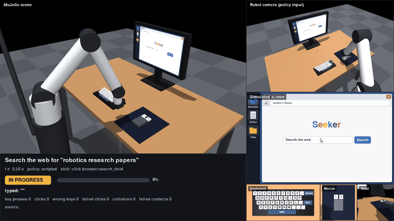
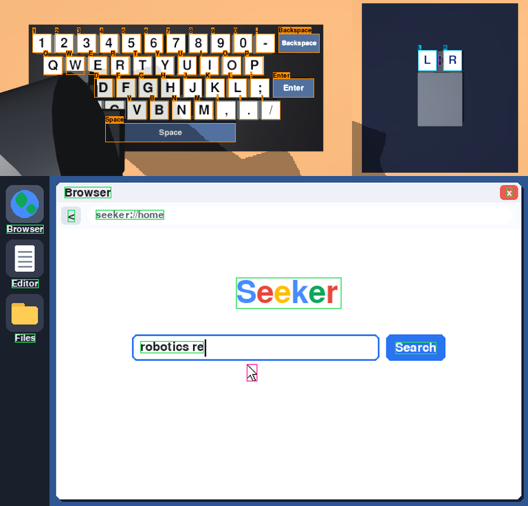
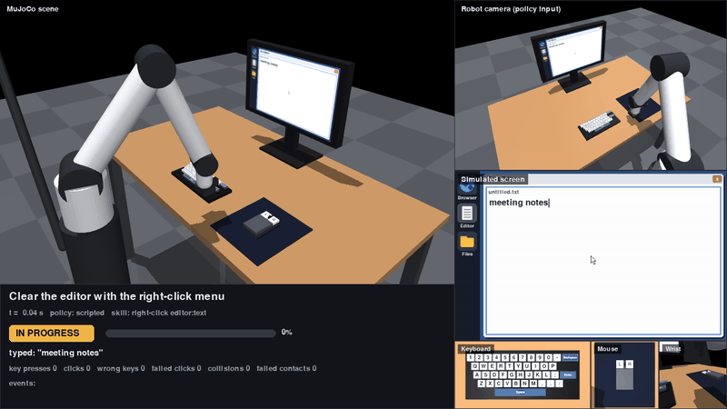

# ComputerXRobot

A MuJoCo robot arm that uses a computer **inside the simulator**: a physical keyboard with
44 labelled, spring-loaded keys, a physical mouse with left and right buttons that slides on
a pad, and a monitor whose screen is a live simulated desktop (text editor, file manager, web
browser with an offline search engine, right-click menus). Key travel and mouse motion are
mapped explicitly to UI events, tasks are checked against the desktop state, and every key
legend, mouse button and piece of screen text is legible in camera images and comes with
ground-truth boxes. A scripted expert, a behaviour-cloning pipeline and an evaluation suite
are included.



*What a model learns from (1.25× speed). The robot searches for "mouse control": it drags the
mouse to the search field, left-clicks, types the query and presses Enter. Then it clears
the editor with the right-click menu: a right-click on **R**, then a left-click on "Clear all"
with **L**. Each panel is a camera image: `keyboard_cam` (all 44 legends readable),
`screen_cam` (the display 1:1) and `mouse_cam` (the **L**/**R** buttons). Boxes are the
ground-truth labels from `env.annotations(camera)`: orange keys, cyan mouse buttons, green
screen text, pink cursor. The key or button being pressed is highlighted bright green, and keys
hidden under the hand are counted as not visible. Regenerate with
`python main.py demo --view perception --task search --text "mouse control" --task clear_text --text "meeting notes" --gif docs/demo.gif --gif-width 960 --speed 1.25`.
The default `--view dashboard` shows the 3D scene, robot camera, screen and task status
instead (`docs/dashboard.png`).*

## Status

| Stage | State |
|---|---|
| **Milestone 1**: robot presses a physical key → character appears in the editor → task manager verifies | ✅ `python main.py` / `tests/test_milestone1.py` |
| 3D environment: arm, desk, monitor, per-key collision bodies, mouse with left/right buttons and pad limits, cameras | ✅ |
| Simulated desktop: editor, file manager, browser (search field, buttons, results, pages), right-click context menus | ✅ |
| Physical → UI mapping: key press, relative mouse → cursor, left button → click, right button → context menu, screen texture refresh | ✅ |
| Legibility: readable key legends, "L"/"R" mouse buttons and screen text in close-up cameras, plus ground-truth boxes/labels for each part | ✅ checked by `tests/test_legibility.py` |
| Scripted expert for every task (type, search, open result, open app, clear text via right-click) | ✅ 100% success, no wrong keys / clicks / collisions |
| Data collection → behaviour cloning → evaluation on unseen tasks | ✅ baseline (see [Results](#results)) |
| Vision-only policy (CNN encoder on camera + screen images) | 🧪 pipeline runs (`--images`); not tuned |
| Gymnasium API: registered envs, state/pixel observations, seeding, vector envs, render modes | ✅ `environment/gym_env.py` |
| RL (PPO/SAC) | ⏳ Gymnasium env and shaped reward are ready; no RL trainer yet |

## Setup

**A100 server (Linux, headless)**

```bash
conda env create -f environment.yml        # python 3.11 + requirements.txt
conda activate robot-sim
nvidia-smi
python -c "import torch; print(torch.cuda.is_available())"
export MUJOCO_GL=egl                       # headless GPU rendering
export SDL_VIDEODRIVER=dummy               # pygame without a display
python main.py                             # milestone 1
```

**Mac (Apple silicon)**

```bash
python3 -m venv .venv && source .venv/bin/activate
pip install -r requirements.txt
python main.py                             # milestone 1 (offscreen rendering uses CGL)
```

MuJoCo physics runs on the CPU; PyTorch uses CUDA when available. No model downloads
are needed: the robot and all devices are defined in `assets/`.

## Usage

```bash
# Milestone 1: press "a", check it appears in the editor
python main.py

# One task with the scripted expert
python main.py demo --task search --text "robotics research papers" --display   # live window
python main.py demo --task open_result --text "mouse control" --video outputs/open_result.mp4
python main.py demo --task type_text --text "hello world" --screenshot outputs/typing.png
python main.py demo --task open_app --text files --gif outputs/open_app.gif   # --gif-width, --gif-fps, --speed
python main.py demo --view perception --task search --task clear_text --display  # labelled camera views; repeat --task to chain

# Right-click: open the editor's context menu and choose "Clear all"
python main.py demo --task clear_text --text "meeting notes" --display

# What a camera sees, with ground-truth boxes and labels (keys, L/R buttons, screen text)
python main.py annotate --camera keyboard_cam --out outputs/keyboard_cam.png
python main.py annotate --camera screen_cam --task search --steps 400 --out outputs/screen.png --json outputs/screen.json

# Interactive MuJoCo viewer (rotate/zoom; the monitor updates live). macOS needs mjpython:
mjpython main.py viewer --task search            # Linux: python main.py viewer ...

# Learning loop
python main.py collect --episodes 40 --out data/demos.npz        # ~200 expert episodes, ~35 s
python main.py train --data data/demos.npz --out checkpoints/bc.pt  # ~10 s on CPU
python main.py evaluate --policy bc --checkpoint checkpoints/bc.pt --split both --episodes 10
python main.py demo --policy bc --checkpoint checkpoints/bc.pt --task search --display

python -m pytest -q                                              # 43 tests, ~10 s
```

Tasks (`--task`): `type_key`, `type_text`, `search`, `open_result`, `open_app`, `clear_text`.
`--text` is the character, string, query, app name or (for `clear_text`) the editor's
starting text; without it the first test-split item is used.

## Seeing and reading the devices



* **Keyboard**: white keycaps with large black legends; Enter, Backspace and Space are dark
  slate with white legends so they read as a group. Legends are painted at 128 px per key
  width.
* **Mouse**: two physical, separately sprung buttons labelled **L** and **R** with a scroll
  wheel between them, white on a dark body on a dark pad. The left button clicks; the right
  button opens a context menu.
* **Screen**: larger, darker UI text; the screen observation defaults to the native
  640×400, and every string drawn is recorded with its box.
* **Close-up cameras**: `keyboard_cam` (256×512, ~32 px per key), `mouse_cam` (320×320) and
  `screen_cam` (400×640, exactly 1:1 with the screen texture). They are fixed, top-down or
  straight-on, and oriented so legends read upright. The wide `robot_cam` gives context, but
  at its size legends are too small to read.
* **Ground truth**: `env.annotations(camera)` (and `env.unwrapped.annotations(camera)` in
  Gymnasium) returns, for every key, mouse button, wheel, screen, screen string and the
  cursor: kind, name, label (`"A"`, `"Enter"`, `"L"`, `"R"`, the text), a pixel box, and
  a `visible` fraction measured from a segmentation render, so parts under the hand are
  marked hidden.

`tests/test_legibility.py` checks that this is readable from pixels alone, by template
correlation on the annotated boxes:
* all 44 key legends are read correctly from `keyboard_cam`;
* "L" and "R" are read from `mouse_cam`, with L on the image's left;
* screen-text crops in `screen_cam` match the real display (correlation above 0.95);
* the key under the robot's finger is reported as hidden.



*`clear_text` at 0.5× speed: the hand lands with the finger over **R**, right-clicks the
editor, lifts and re-lands on **L**, then clicks "Clear all" in the context menu.*

## Gymnasium API

```python
import gymnasium as gym
import environment.gym_env  # registers the ComputerXRobot/* environments

env = gym.make("ComputerXRobot/Search-v0", obs_mode="pixels")   # or "state" / "both"
obs, info = env.reset(seed=0)            # obs: {"robot_cam": 240x320x3, "screen": 400x640x3}
action = env.action_space.sample()       # or env.unwrapped.expert_action()
obs, reward, terminated, truncated, info = env.step(action)
info["ui_state"]                         # ground truth: editor text, cursor, page, menu, ...
info["screen_text"]                      # every string on screen with its pixel box

# Close-ups in which legends, L/R buttons and screen text are legible:
env = gym.make("ComputerXRobot/ComputerUse-v0", obs_mode="pixels",
               cameras=("robot_cam", "keyboard_cam", "mouse_cam", "screen_cam"))
env.unwrapped.annotations("keyboard_cam")  # boxes + labels for each key
```

| | |
|---|---|
| IDs | `ComputerXRobot/ComputerUse-v0` (all tasks), `TypeKey-v0`, `TypeText-v0`, `Search-v0`, `OpenResult-v0`, `OpenApp-v0`, `ClearText-v0` |
| Action | `Box(-1, 1, (4,))`: tool-target change `dx, dy, dz` (×6 mm per step) and finger (-1 retracted … 1 fully extended) |
| Observation | `obs_mode="state"`: `Box(67,)` features; `"pixels"`: dict of uint8 images (`cameras`, default `robot_cam`, plus `screen`); `"both"`: pixels plus `"state"`. Camera sizes default per camera (`image_size` takes `(H, W)` or `{camera: (H, W)}`); `screen_size` defaults to the native 400×640 |
| Episodes | each `reset` samples a task from `tasks`/`split` with the env's RNG, or pass `options={"task": "search", "text": "..."}`. `terminated` = task succeeded, `truncated` = task time limit |
| Reward | progress gained, +1 on success, −0.1 per wrong key or failed click (a solved episode returns 2.0) |
| `info` | `task`, `text`, `instruction`, `is_success`, `progress`, `expected` (next char / click target; `"right:<widget>"` = right-click), `ui_state`, `screen_text`, `events`; `metrics` at episode end |
| Render | `render_mode="rgb_array"` returns the 1280×720 dashboard (works with `gymnasium.wrappers.RecordVideo`, which needs `pip install "gymnasium[other]"`); `"human"` opens a window |
| Speed (this Mac) | ~2,000 steps/s in `state` mode; with pixels ~190 steps/s at the defaults (robot_cam 240×320 + screen 400×640), ~300 at 64×64 + 64×96, ~67 with robot, keyboard, mouse and screen cameras; `gym.vector.AsyncVectorEnv` runs several envs in parallel |

The env passes `gymnasium.utils.env_checker.check_env` in all three observation modes. The
scene itself is not randomised yet: layout, lighting and cameras are fixed, and only the
task and its text vary between episodes.

## How it works

### Scene (`assets/`, `environment/scene.xml`)

| Component | Model |
|---|---|
| Robot | 5-DOF arm (base yaw, shoulder, elbow, wrist pitch, wrist roll) on a pedestal, position servos with gravity compensation, plus a **finger**: a 30 mm prismatic plunger in front of the palm. The palm rests on the mouse; the finger presses keys and the mouse buttons. |
| Keyboard | 44 keys generated from `environment/keyboard_layout.py` (digits, letters, `- ; , . /`, Space, Enter, Backspace). Each key is a body on a slide joint: 4 mm travel, 0.45 N preload, own collision box, legend painted at runtime (black on white; white on slate for Enter/Backspace/Space). |
| Mouse | Shell on two slide joints (x/y, pad limits, friction loss so it stays put), flat palm rest, and left/right buttons (labelled L/R) on their own spring-loaded slide joints, with a scroll wheel between them. |
| Monitor | 0.48 × 0.30 m screen; its 640 × 400 texture is overwritten with the pygame desktop and re-uploaded to the GPU whenever the desktop changes. |
| Cameras | `robot_cam` (mast-mounted, policy input), `wrist_cam`, legible close-ups `keyboard_cam`, `mouse_cam`, `screen_cam`, and observers `overview`, `front_view`, `side_view`, `top_view`. |

Collision filtering: robot geoms collide only with environment geoms. Keys, mouse and
desk never collide with each other, so contacts are exactly "robot touched something".

### Physical interaction → UI events (`control/contact_detection.py`, `environment/ui_events.py`)

| Physical event | Detection | UI event |
|---|---|---|
| Key pressed | key joint travels past 60 % of its stroke (released below 30 %: hysteresis, no repeats) | `desktop.key_press(char)` |
| Mouse moved | change of the mouse joint positions since the last physics step | cursor moves 6400 px/m (relative, like a real mouse; push away = up, right = right) |
| Left button pressed | left button joint past 60 % of its stroke | `desktop.click("left")` on the widget under the cursor |
| Right button pressed | right button joint past 60 % of its stroke | `desktop.click("right")`: context menu at the cursor (editor: Clear all; browser: Back, Home; plus Close window / Open app) |
| Desktop changed | desktop version counter | screen texture rewritten and uploaded to every renderer |

Devices are polled **every physics step** (500 Hz), so short presses are never missed.

### Control loop (`environment/computer_env.py`)

Per control step (50 Hz):

1. observe: robot camera, screen image, joint states, task state;
2. the policy picks an action `[dx, dy, dz, finger]` (tool-target change ≤ 6 mm, finger command 0–1);
3. damped-least-squares IK turns the tool target into joint targets (hand kept pointing down);
4. 10 physics steps; keyboard/mouse polled and mapped to UI events after each;
5. task check: success, progress-shaped reward, timeout;
6. the episode (observations, actions, rewards, UI events) is recorded.

### Tasks (`environment/task_manager.py`)

Each task sets up the desktop, decides success **from the desktop state only**, and exposes
an `expectation()`: the next character to type or the next widget to click (`"right:<widget>"`
for a right-click). That drives
the expert, annotates every UI event as correct or wrong, and is part of the policy's
"task state" observation. Content has disjoint **train/test splits** (e.g. typing `"quick"`
vs `"jazz"`; searching `"pasta recipe"` vs `"robotics research papers"`), so the test split
measures generalisation to unseen tasks.

### Scripted expert (`learning/scripted_policy.py`)

A memoryless controller: from the expectation and the device state it picks a waypoint and a
finger command. It flies to the hover point above a key and ramps the finger out as it
arrives. For clicks it glides onto the mouse with the finger over the needed button (L or R;
it lifts and re-lands to switch), servos the hand on the cursor error, then clicks. Because it holds no hidden phase, it recovers from slip and perturbations, and
behaviour cloning can fit it.

### Learning (`learning/dataset.py`, `learning/policy.py`)

* **Inputs**: 67 low-dimensional features: tool target and tracking error, finger, mouse offset,
  contact flags, cursor, click target, left/right button needed, that button's position relative
  to the hand, and a one-hot of the next character. Optionally 64 × 64 camera and screen images through small CNN encoders
  (`--images`).
* **Labels**: the expert's waypoint relative to the tool target (cm, clipped to 5 cm) plus the
  finger command, not the clipped per-step action. Near the goal this is close to linear
  in the inputs, which an MLP fits to millimetre precision.
* **Data**: expert rollouts with DART-style perturbations. Every so often the executed motion is
  pushed off course for 3–9 steps while the label stays the clean expert action, so the
  data includes recoveries.
* **Model**: a 3 × 256 MLP trained with smooth-L1 loss (AdamW, cosine schedule).

## Results

`python main.py evaluate --split both --episodes 10` per cell (10 episodes per task and
split, on this Mac). "Seen" uses training-split content, "unseen" uses the held-out test
split. For `type_key` and `open_app` both splits contain the same items (every key, every
app). BC numbers come from one training run (`collect --episodes 40`, `train` defaults) and
vary between runs.

| Task | Expert success (seen / unseen) | Expert mean time | BC success (seen / unseen) | BC wrong keys / failed clicks per episode (unseen) |
|---|---|---|---|---|
| `type_key` | 100% / 100% | 0.9 s | 100% / 100% | 0 / 0 |
| `type_text` | 100% / 100% | 2.7 s | 100% / 100% | 0.3 / 0 |
| `search` | 100% / 100% | 8.7 s | 100% / 100% | 2.0 / 0 |
| `open_result` | 100% / 100% | 10.0 s | 100% / 100% | 2.0 / 0 |
| `open_app` | 100% / 100% | 1.3 s | 100% / 100% | 0 / 0 |
| `clear_text` | 100% / 100% | 1.6 s | 0% / 0% | 0 / 0 |

Neither policy had robot collisions in these runs. The expert never pressed a wrong key or
clicked the wrong widget. The BC policy solves every task except `clear_text`, including
unseen strings and queries. It presses a few extra keys, which it fixes with backspace
because the task then asks for `\b`.

`clear_text` needs a right-click, then a left-click. With one finger the hand must lift off
the R button and re-land on L. BC right-clicks correctly but stalls before the menu click.
With 4× more `clear_text` demonstrations BC solves it, but `open_app` and `open_result` drop
to 0%: one MLP blends "switch buttons" with "drag the cursor". A hand with a second finger
over the R button would remove the switch (see Next steps). Full per-episode results go to
`outputs/eval_*.json`.

## Project structure

```
assets/
  robot.xml            5-DOF arm + finger, actuators, wrist and mast cameras
  desk.xml             desk, monitor (dynamic screen texture), mouse pad, mouse
  keyboard.xml         GENERATED: python -m environment.keyboard_layout
environment/
  scene.xml            full MuJoCo scene (opens in `python -m mujoco.viewer`)
  keyboard_layout.py   key layout, characters, label atlas, keyboard.xml generator
  browser.py           simulated desktop: dock, editor, files, browser (pygame)
  web_content.py       offline web pages + keyword search
  screen.py            desktop -> monitor texture, key / mouse legends, RGB + segmentation renderer
  annotations.py       ground-truth boxes, labels and visibility per camera
  ui_events.py         physical interaction -> UI events
  task_manager.py      tasks, splits, success checks, reward, event bookkeeping
  computer_env.py      core simulation environment tying everything together
  gym_env.py           Gymnasium wrapper + registered ComputerXRobot/* env IDs
control/
  robot_controller.py  damped-least-squares IK and actuator targets
  contact_detection.py key/button press detection, contact classification
learning/
  scripted_policy.py   expert for every task
  dataset.py           features, demonstration collection and storage
  policy.py            behaviour cloning (MLP + optional CNN encoders)
evaluation/
  task_success.py      episode runner, task suites
  metrics.py           success rate, time, wrong keys, failed clicks, collisions
  dashboard.py         demo views: dashboard (3D / camera / screen / result), perception (labelled cameras)
tests/                 milestone 1, UI mapping, desktop/tasks, pipeline, demo outputs, Gymnasium API, legibility
docs/                  demo.gif, right_click.gif, devices.png, dashboard.png
main.py                CLI: demo (display / mp4 / gif / png), viewer, annotate, collect, train, evaluate
```

## Design notes and limitations

* **Own arm instead of a Menagerie model.** The 5-DOF arm with a plunger finger needs no
  download and makes key presses and clicks reliable; the hand always points down with a
  fixed heading. Swapping in a Franka from MuJoCo Menagerie means replacing
  `assets/robot.xml` and the joint names in `control/robot_controller.py`.
* **Privileged expert and features.** The expert and the low-dim policy read simulator
  state (key positions, cursor and widget positions, mouse position). The next research
  step is to replace those inputs with perception from `robot_cam`/`screen`.
* **Mouse physics** is planar (slide joints with friction loss), dragged by palm friction.
  There is no lifting or repositioning; with this gain the pad covers the whole screen.
* **The GUI is hand-built** (pygame), not a real OS: fixed layout, one window at a time,
  no scrolling, lowercase keyboard without modifier keys. The scroll wheel is visual only.
* **Legibility needs resolution.** Legends and screen text are readable in the close-up
  cameras at their default sizes. In the wide `robot_cam`, or with images shrunk to 64×64,
  they are not, whatever the textures.
* MJX is not used: the UI loop runs on the CPU in Python and the env runs about 2000 control
  steps/s headless, which is enough for imitation learning. Batched GPU simulation would
  need the device/UI mapping in JAX.

## Next steps

1. Vision-based policy: train with `--images` (and the device cameras) and drop privileged
   features progressively (start with the mouse position, then the click-target
   coordinates); `env.annotations()` gives supervision for key, button and text detection.
2. A second finger over the R mouse button, so right-clicks need no lift-and-switch (the
   step behaviour cloning cannot yet learn alongside the other mouse tasks).
3. Action chunking or a diffusion policy to reduce the remaining wrong key presses.
4. RL fine-tuning (PPO/SAC) from the BC initialisation through the Gymnasium env.
5. World-model data: domain randomisation (layout, lighting, cameras) and a trajectory
   logger (images, executed actions, rewards, episode ends, UI state).
6. More apps and long-horizon tasks: drag and drop, file operations, multi-window.
