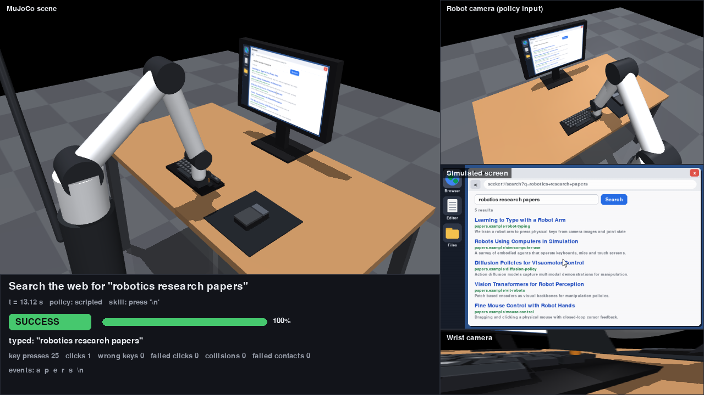

# ComputerXRobot

A MuJoCo robot arm that uses a computer **inside the simulator**: a physical keyboard with
44 spring-loaded keys, a physical mouse that slides on a pad, and a monitor whose screen is a
live simulated desktop (text editor, file manager, web browser with an offline search
engine). Key travel and mouse motion are mapped explicitly to UI events, tasks are checked
against the desktop state, and a scripted expert, a behaviour-cloning pipeline and an
evaluation suite are included.



*`python main.py demo --task search --text "robotics research papers" --display`: the 3D
robot, its camera observation, the simulated screen and the task result in one view.*

## Status

| Stage | State |
|---|---|
| **Milestone 1**: robot presses a physical key → character appears in the editor → task manager verifies | ✅ `python main.py` / `tests/test_milestone1.py` |
| 3D environment: arm, desk, monitor, per-key collision bodies, mouse with button and pad limits, cameras | ✅ |
| Simulated desktop: editor, file manager, browser (search field, buttons, results, pages) | ✅ |
| Physical → UI mapping: key press, relative mouse → cursor, button → click, screen texture refresh | ✅ |
| Scripted expert for every task (type, search, open result, open app) | ✅ 100% success, no wrong keys / clicks / collisions |
| Data collection → behaviour cloning → evaluation on unseen tasks | ✅ baseline (see [Results](#results)) |
| Vision-only policy (CNN encoder on camera + screen images) | 🧪 pipeline runs (`--images`); not tuned |
| RL (PPO/SAC) | ⏳ env has the reward signal; no RL trainer yet |

## Setup

**A100 server (Linux, headless)**

```bash
conda env create -f environment.yml        # python 3.11 + requirements.txt
conda activate robot-sim
nvidia-smi
python -c "import torch; print(torch.cuda.is_available())"
export MUJOCO_GL=egl                       # headless GPU rendering
export SDL_VIDEODRIVER=dummy               # pygame without a display
python main.py                             # milestone 1
```

**Mac (Apple silicon)**

```bash
python3 -m venv .venv && source .venv/bin/activate
pip install -r requirements.txt
python main.py                             # milestone 1 (offscreen rendering uses CGL)
```

MuJoCo physics runs on the CPU; PyTorch uses CUDA when available. No model downloads
are needed: the robot and all devices are defined in `assets/`.

## Usage

```bash
# Milestone 1: press "a", check it appears in the editor
python main.py

# One task with the scripted expert
python main.py demo --task search --text "robotics research papers" --display   # live window
python main.py demo --task open_result --text "mouse control" --video outputs/open_result.mp4
python main.py demo --task type_text --text "hello world" --screenshot outputs/typing.png

# Interactive MuJoCo viewer (rotate/zoom; the monitor updates live). macOS needs mjpython:
mjpython main.py viewer --task search            # Linux: python main.py viewer ...

# Learning loop
python main.py collect --episodes 40 --out data/demos.npz        # ~200 expert episodes, ~35 s
python main.py train --data data/demos.npz --out checkpoints/bc.pt  # ~10 s on CPU
python main.py evaluate --policy bc --checkpoint checkpoints/bc.pt --split both --episodes 10
python main.py demo --policy bc --checkpoint checkpoints/bc.pt --task search --display

python -m pytest -q                                              # 21 tests, ~3 s
```

Tasks (`--task`): `type_key`, `type_text`, `search`, `open_result`, `open_app`. `--text` is
the character/string/query/app name; without it the first test-split item is used.

## How it works

### Scene (`assets/`, `environment/scene.xml`)

| Component | Model |
|---|---|
| Robot | 5-DOF arm (base yaw, shoulder, elbow, wrist pitch, wrist roll) on a pedestal, position servos with gravity compensation, plus a **finger**: a 30 mm prismatic plunger in front of the palm. The palm rests on the mouse; the finger presses keys and the mouse button. |
| Keyboard | 44 keys generated from `environment/keyboard_layout.py` (digits, letters, `- ; , . /`, space, enter, backspace). Each key is a body on a slide joint: 4 mm travel, 0.45 N preload, own collision box, label painted at runtime. |
| Mouse | Shell on two slide joints (x/y, pad limits, friction loss so it stays put), flat palm rest, spring-loaded button on its own slide joint. |
| Monitor | 0.48 × 0.30 m screen; its 640 × 400 texture is overwritten with the pygame desktop and re-uploaded to the GPU whenever the desktop changes. |
| Cameras | `robot_cam` (mast-mounted, policy input), `wrist_cam`, `overview`, `front_view`, `side_view`, `top_view`, `screen_cam`. |

Collision filtering: robot geoms collide only with environment geoms. Keys, mouse and
desk never collide with each other, so contacts are exactly "robot touched something".

### Physical interaction → UI events (`control/contact_detection.py`, `environment/ui_events.py`)

| Physical event | Detection | UI event |
|---|---|---|
| Key pressed | key joint travels past 60 % of its stroke (released below 30 %: hysteresis, no repeats) | `desktop.key_press(char)` |
| Mouse moved | change of the mouse joint positions since the last physics step | cursor moves 6400 px/m (relative, like a real mouse; push away = up, right = right) |
| Mouse button pressed | button joint past 60 % of its stroke | `desktop.click()` on the widget under the cursor |
| Desktop changed | desktop version counter | screen texture rewritten and uploaded to every renderer |

Devices are polled **every physics step** (500 Hz), so short presses are never missed.

### Control loop (`environment/computer_env.py`)

Per control step (50 Hz):

1. observe: robot camera, screen image, joint states, task state;
2. the policy picks an action `[dx, dy, dz, finger]` (tool-target change ≤ 6 mm, finger command 0–1);
3. damped-least-squares IK turns the tool target into joint targets (hand kept pointing down);
4. 10 physics steps; keyboard/mouse polled and mapped to UI events after each;
5. task check: success, progress-shaped reward, timeout;
6. the episode (observations, actions, rewards, UI events) is recorded.

### Tasks (`environment/task_manager.py`)

Each task sets up the desktop, decides success **from the desktop state only**, and exposes
an `expectation()`: the next character to type or the next widget to click. That drives
the expert, annotates every UI event as correct or wrong, and is part of the policy's
"task state" observation. Content has disjoint **train/test splits** (e.g. typing `"quick"`
vs `"jazz"`; searching `"pasta recipe"` vs `"robotics research papers"`), so the test split
measures generalisation to unseen tasks.

### Scripted expert (`learning/scripted_policy.py`)

A memoryless controller: from the expectation and the device state it picks a waypoint and a
finger command. It flies to the hover point above a key and ramps the finger out as it
arrives. For clicks it glides onto the mouse, servos the hand on the cursor error, then
clicks. Because it holds no hidden phase, it recovers from slip and perturbations, and
behaviour cloning can fit it.

### Learning (`learning/dataset.py`, `learning/policy.py`)

* **Inputs**: 66 low-dimensional features: tool target and tracking error, finger, mouse offset,
  contact flags, cursor, click target, mouse position relative to the hand, and a one-hot of the
  next character. Optionally 64 × 64 camera and screen images through small CNN encoders
  (`--images`).
* **Labels**: the expert's waypoint relative to the tool target (cm, clipped to 5 cm) plus the
  finger command, not the clipped per-step action. Near the goal this is close to linear
  in the inputs, which an MLP fits to millimetre precision.
* **Data**: expert rollouts with DART-style perturbations. Every so often the executed motion is
  pushed off course for 3–9 steps while the label stays the clean expert action, so the
  data includes recoveries.
* **Model**: a 3 × 256 MLP trained with smooth-L1 loss (AdamW, cosine schedule).

## Results

`python main.py evaluate --split both --episodes 10` per cell (10 episodes per task and
split, on this Mac). "Seen" uses training-split content, "unseen" uses the held-out test
split. For `type_key` and `open_app` both splits contain the same items (every key, every
app). BC numbers come from one training run (`collect --episodes 40`, `train` defaults) and
vary between runs.

| Task | Expert success (seen / unseen) | Expert mean time | BC success (seen / unseen) | BC wrong keys / failed clicks per episode (unseen) |
|---|---|---|---|---|
| `type_key` | 100% / 100% | 0.3 s | 100% / 100% | 0 / 0 |
| `type_text` | 100% / 100% | 2.1 s | 90% / 90% | 0.7 / 0 |
| `search` | 100% / 100% | 9.4 s | 90% / 80% | 2.6 / 0 |
| `open_result` | 100% / 100% | 10.7 s | 70% / 100% | 4.0 / 10.5 |
| `open_app` | 100% / 100% | 1.8 s | 100% / 100% | 0 / 0 |

Neither policy had robot collisions in these runs. The expert never pressed a wrong key or
clicked the wrong widget; it averaged 0.3–0.4 failed button contacts per `open_app` episode.
The BC policy completes every task type, including unseen strings and queries, but presses
extra keys (fixed with backspace, since the task then asks for `\b`) and misses clicks; on
`open_result` it often needs several clicks. Full per-episode results go to
`outputs/eval_*.json`.

## Project structure

```
assets/
  robot.xml            5-DOF arm + finger, actuators, wrist and mast cameras
  desk.xml             desk, monitor (dynamic screen texture), mouse pad, mouse
  keyboard.xml         GENERATED: python -m environment.keyboard_layout
environment/
  scene.xml            full MuJoCo scene (opens in `python -m mujoco.viewer`)
  keyboard_layout.py   key layout, characters, label atlas, keyboard.xml generator
  browser.py           simulated desktop: dock, editor, files, browser (pygame)
  web_content.py       offline web pages + keyword search
  screen.py            desktop -> monitor texture, keycap labels, offscreen renderer
  ui_events.py         physical interaction -> UI events
  task_manager.py      tasks, splits, success checks, reward, event bookkeeping
  computer_env.py      gym-style environment tying everything together
control/
  robot_controller.py  damped-least-squares IK and actuator targets
  contact_detection.py key/button press detection, contact classification
learning/
  scripted_policy.py   expert for every task
  dataset.py           features, demonstration collection and storage
  policy.py            behaviour cloning (MLP + optional CNN encoders)
evaluation/
  task_success.py      episode runner, task suites
  metrics.py           success rate, time, wrong keys, failed clicks, collisions
  dashboard.py         combined 3D / camera / screen / result view
tests/                 milestone 1, UI mapping, desktop/tasks, end-to-end pipeline
main.py                CLI: demo, viewer, collect, train, evaluate
```

## Design notes and limitations

* **Own arm instead of a Menagerie model.** The 5-DOF arm with a plunger finger needs no
  download and makes key presses and clicks reliable; the hand always points down with a
  fixed heading. Swapping in a Franka from MuJoCo Menagerie means replacing
  `assets/robot.xml` and the joint names in `control/robot_controller.py`.
* **Privileged expert and features.** The expert and the low-dim policy read simulator
  state (key positions, cursor and widget positions, mouse position). The next research
  step is to replace those inputs with perception from `robot_cam`/`screen`.
* **Mouse physics** is planar (slide joints with friction loss), dragged by palm friction.
  There is no lifting or repositioning; with this gain the pad covers the whole screen.
* **The GUI is hand-built** (pygame), not a real OS: fixed layout, one window at a time,
  no scrolling, lowercase keyboard without modifier keys.
* MJX is not used: the UI loop runs on the CPU in Python and the env runs about 2000 control
  steps/s headless, which is enough for imitation learning. Batched GPU simulation would
  need the device/UI mapping in JAX.

## Next steps

1. Vision-based policy: train with `--images` and drop privileged features progressively
   (start with the mouse position, then the click-target coordinates).
2. Action chunking or a diffusion policy to reduce the remaining wrong key presses.
3. RL fine-tuning (PPO/SAC) from the BC initialisation using the env's shaped reward.
4. More apps and long-horizon tasks: drag and drop, file operations, multi-window.
